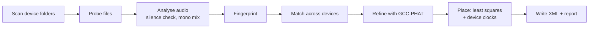

# How it works

All the work happens in `slingsync/engine.py`, in `run()`. The pipeline:



## 1. Scan and probe

`scan_devices()` lists each non-hidden subfolder of the project as a device and walks it for files with a recognised extension. A device is a *camera* if it has any video file.

`probe()` opens each file with PyAV (FFmpeg libraries bundled, no system FFmpeg needed) and reads its duration, audio streams and channel counts, sample rate, video frame rate and size, and a **date hint**. The date hint comes from, in order of preference:

1. Broadcast WAV `bext` fields (`origination_date` plus `time_reference` or `origination_time`), i.e. the recorder's own clock. Labelled *recorder clock*.
2. Container metadata: `com.apple.quicktime.creationdate`, `creation_time` or `date`. Labelled *file metadata*.
3. The file's creation time on disk (or modification time minus duration). Labelled *file date*.

Unreadable files are skipped and listed in the report.

## 2. Audio analysis (`analyze`)

Each file is decoded twice at **8 kHz**, streaming, so memory stays low on long files.

**Pass 1, silence detection.** Per-channel RMS in 50 ms frames. A channel is *silent* if its 95th-percentile level is below `silence_db` (−60 dBFS), or if its dynamic range (95th minus 10th percentile) is under `flat_db` (3 dB). The second rule catches dead inputs and hiss-only channels that are loud but contain nothing.

**Pass 2, mono mix.** Live channels are normalised to their 90th-percentile level and averaged, so a hot lav doesn't drown out a quiet camera mic. If a reference channel is set and is live in this file, only that channel is used.

The mix is saved as `<hash>_mono.npy` in the cache. Metadata (silent/used channels, levels, notes) is saved as JSON.

## 3. Fingerprinting (`fingerprint`)

A landmark fingerprint in the style of Shazam:

- STFT with 512-sample frames and a 128-sample hop (16 ms resolution), keeping 200 Hz to 3.5 kHz.
- Spectral peaks are local maxima in an 11×11 neighbourhood above an adaptive threshold. At most 25 peaks per second are kept, strongest first.
- Each peak is paired with up to 5 later peaks within 48 frames (~0.77 s) and ±60 bins. Each pair becomes a hash `(f1, f2 − f1, Δt)` packed into an integer, stored with the time of the first peak.

Hashes and times are saved as `<hash>_fp.npz`.

## 4. Matching (`match_all`)

All hashes from all clips are concatenated and sorted once. For each clip, every hash is looked up with binary search. Hashes shared by more than 60 entries are ignored as too common.

Each hit against a clip **from a different device** votes for a time offset (`tA − tB`). Per clip pair, the winning offset (±1 frame) must have:

- at least `min_votes` votes (default 12), and
- at least 2× the votes of the best offset more than 2 frames away.

The second rule rejects repetitive sound (music loops, beeps) that would give several equally plausible offsets. Each accepted pair becomes an *edge* with an offset accurate to ~16 ms.

This needs no rough positions to start from, and its cost grows roughly linearly with the number of clips, not with the number of pairs.

## 5. Refinement (`refine`)

Each edge is refined to sample accuracy at 8 kHz (0.125 ms) with **GCC-PHAT** cross-correlation:

- Up to 5 windows of up to 8 s each are spread across the overlap, each searching ±60 ms around the coarse offset.
- The cross-spectrum is limited to 150 Hz to 3.5 kHz and whitened with a softened PHAT weight (|R|^0.75).
- The refined offset is the median of the windows, accepted only if at least 3 of 5 agree within 0.25 ms. Otherwise the coarse offset is kept.

Overlaps shorter than 1 s aren't refined.

## 6. Placement (`place`)

**Connected groups.** Edges are added strongest first to a union-find structure, producing a spanning tree per group of clips that are connected by sound. Positions are propagated along the tree.

**Least squares.** For every group of 3 or more clips, *all* edges consistent with the tree (within 50 ms) are solved together by weighted least squares (`scipy.sparse.linalg.lsqr`). Weights are √votes, doubled for refined edges. Two passes are run. This spreads small errors across the network instead of letting them pile up along a chain. Edges still off by more than 80 ms afterwards are reported as *inconsistent matches*.

**Groups without shared sound.** The largest group (by clip count, then total duration) becomes the main timeline. Every other group is positioned using **device clocks**:

- Each device's clock is modelled as *audio timeline + a constant offset*.
- Offsets for devices and positions for groups are estimated together by alternating medians over every clip that has a date.
- Some cameras stamp the **start** of a recording and some stamp the **end**. For up to 8 devices, SlingSync tries every start/end combination and keeps the one that places the most groups with the smallest error.

Groups that can't be linked to any device clock are marked **NOT PLACED** and parked after the end of the timeline, 30 s after the last clip and then 10 s apart.

Finally the whole timeline is shifted so the earliest clip starts at 0.

## 7. XML (`build_xml`)

Output is Final Cut Pro 7 XML (`xmeml` version 4), which Premiere imports.

- Positions are rounded to whole frames at the sequence rate. 23.976 / 29.97 / 59.94 are written as NTSC timebases.
- For each device, clips are packed into **lanes**, using as few tracks as possible without overlaps.
- Per lane: one video track (cameras only) and one audio track per kept channel, each clip item pointing at its source channel via `<sourcetrack>`.
- All items of the same source clip are linked.
- Status colours are written as `<label2>`.
- Media is referenced by absolute `file://localhost/…` URL, so files are used in place.

## Cache layout

```
<project>/.slingsync_cache/
    <sha1>.json        silent/used channels, levels, note
    <sha1>_mono.npy    8 kHz mono mix (float32)
    <sha1>_fp.npz      fingerprint hashes + times
```

The key is a SHA-1 of `version|path|size|mtime|ref channel|silence_db|flat_db`. Changing the app version, the file, or any analysis setting invalidates it.

## Key constants

| Constant | Value | Meaning |
|---|---|---|
| `SR` | 8000 | Analysis sample rate (Hz) |
| `N_FFT` / `HOP` | 512 / 128 | STFT frame and hop (16 ms resolution) |
| `BIN_LO`–`BIN_HI` | 13–225 | ~200 Hz to 3.5 kHz |
| `PEAKS_PER_SEC` | 25 | Peak density cap |
| `FANOUT` | 5 | Pairs per anchor peak |
| `MAX_DT` / `MAX_DF` | 48 frames / 60 bins | Pairing window |
| `BUCKET_CAP` | 60 | Ignore hashes more common than this |
